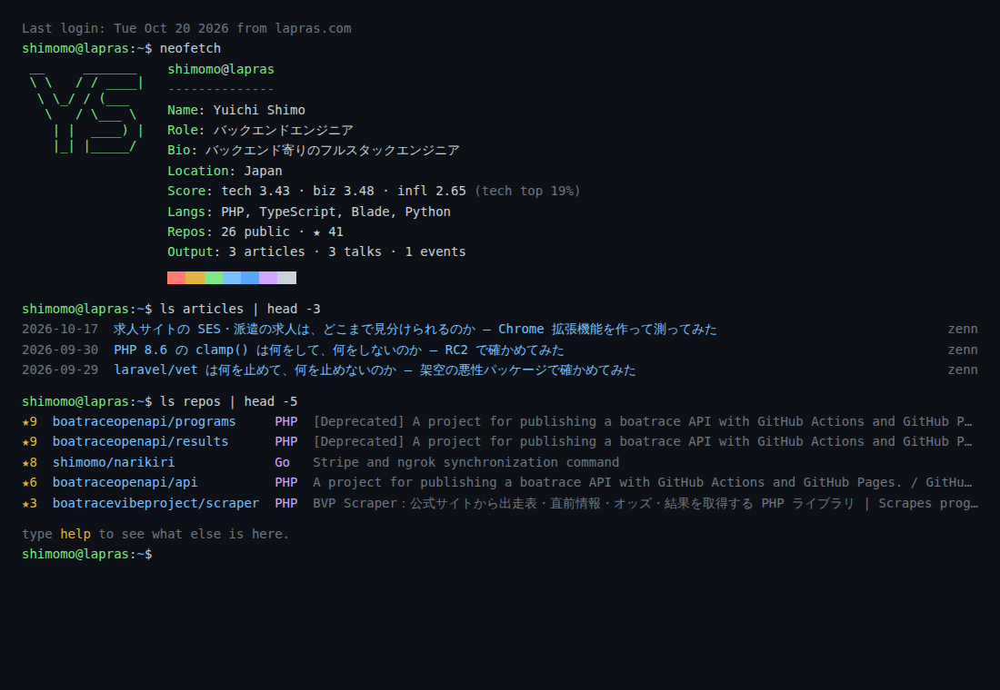

# lapras-portfolio

[LAPRAS](https://lapras.com/) の公開 API から、自分のポートフォリオページを GitHub Pages に毎日自動で公開する仕組みです。フォークして `config.json` の ID を書き換えるだけで使えます。

**デモ:** https://shimomo.github.io/lapras-portfolio/



ぱっと見はただのターミナル。でも中身は、LAPRAS のスコア・記事・登壇・リポジトリです。

## 自分のページを作る

**前提:** LAPRAS でポートフォリオを公開設定にしておきます。公開ページの URL `https://lapras.com/public/<ID>` の `<ID>` が、あなたの ID です。

1. このリポジトリを **フォーク** する
2. フォークした先の **Actions** タブを開き、ワークフローを有効にする
3. **Settings → Pages → Source** を「**GitHub Actions**」にする
4. `config.json` の `lapras_id` を自分の ID に書き換えてコミットする

```json
{
  "lapras_id": "<あなたの ID>",
  "theme": "terminal"
}
```

数分で `https://<ユーザー名>.github.io/lapras-portfolio/` に公開されます。あとは毎朝 6 時ごろ（日本時間）に自動で更新されます。

`lapras_id` には公開ページの URL をそのまま貼っても大丈夫です。

## 修正を取り込む

こちらで入れた修正（LAPRAS 側のデータ形式の変更への対応、テーマの改善など）は、フォークの画面の **Sync fork → Update branch** で取り込めます。

`config.json` と `data/<あなたの ID>/` は上流（このリポジトリ）では書き換えないので、取り込むときにぶつかりません。

## テンプレートから作る場合

「Use this template」で作っても動きます。手順 2 が要らないかわりに、こちらの修正は届きません（必要なら手で取り込んでください）。

## テーマ

`config.json` の `theme` で切り替えます。

| テーマ | 見た目 |
| --- | --- |
| `terminal`（既定） | 黒い画面のターミナル。コマンドを打って中身を見ていく |
| `dashboard` | 明るい背景のカードグリッド |

### terminal で使えるコマンド

| コマンド | 内容 |
| --- | --- |
| `help` | 使えるコマンドの一覧（クリックでも実行できます） |
| `neofetch` | プロフィールの概要 |
| `whoami` | 名前と bio |
| `ls` / `ls articles` / `ls repos` / `ls talks` / `ls events` | 一覧 |
| `lapras score` | LAPRAS のスコア |
| `langs` | よく書く言語 |
| `skills` | スキルタグ |
| `git log` | 最近の活動 |
| `open` / `open github` など | リンク一覧 / 開く |
| `cat README.md` | このページについて |
| `history` / `clear` | 履歴 / 画面クリア |

`| head -N` や Tab 補完、↑↓ の履歴も使えます。データの無い項目のコマンドは出てきません。ほかにもいくつか隠しコマンドがあります。

## テーマを足す

`themes/<名前>/index.ts` を作り、`Theme`（[`src/types.ts`](src/types.ts)）を default export します。ディレクトリを足すだけで `config.json` の `theme` に書けるようになり、既存のファイルを書き換える必要はありません。

```ts
import { html } from "../../src/html.js";
import type { Theme } from "../../src/types.js";

const theme: Theme = {
  assets: ["style.css"], // themes/<名前>/ にあるファイル。index.html の隣にコピーされる
  render: (data, meta) => html`<!DOCTYPE html>
<html lang="ja"><head><link rel="stylesheet" href="style.css"></head>
<body><h1>${data.name}</h1></body></html>`.value,
};

export default theme;
```

- 受け取るデータの形は `PortfolioData`（[`src/types.ts`](src/types.ts)）です。LAPRAS の JSON を直接読む必要はありません
- `html` タグに埋め込んだ値は自動でエスケープされます
- サイト内の参照は相対パスにしてください（`/` で始めない）。`<user>.github.io/<repo>/` の下でも動くようにするためです

## うまくいかないとき

| 症状 | 確かめること |
| --- | --- |
| ページが出ない | Settings → Pages → Source が「GitHub Actions」になっているか。Actions タブで `build-deploy` が失敗していないか |
| `LAPRAS のポートフォリオが見つかりません` で失敗する | LAPRAS でポートフォリオが公開設定になっているか。`lapras_id` が正しいか |
| 「まだ設定されていません」と出る | `config.json` の `lapras_id` が `shimomo` のまま。自分の ID に書き換えてください |
| 更新が止まった | Actions タブで `build-deploy` が無効になっていないか。無効なら有効にして、手動で実行（Run workflow） |
| フォークで何も動かない | Actions タブでワークフローを有効にしたか |

## 開発

```bash
npm ci
npm test                 # ユニットテスト（Vitest）
npm run test:browser     # ブラウザでの確認（Playwright）
npm run build            # config.json の ID で dist/ を生成
```

## クレジット

データは [LAPRAS](https://lapras.com/) の公開 API（仕様: [lapras-inc/public-api-schema](https://github.com/lapras-inc/public-api-schema)）から取得しています。

## ライセンス

[MIT](LICENSE)
